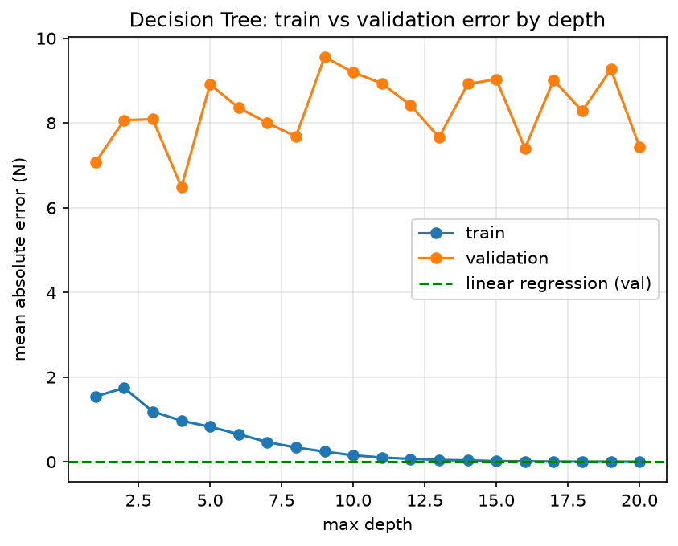

# flight-control-ml

Training scikit-learn models to reproduce a 2D PD flight controller I wrote and measuring where they fail.

## The data
`flight_data.csv` comes from my previous project, [position-control-2d](https://github.com/glazarak/position-control-2d).
It's 20 simulated drone flights, 500 timesteps each (dt = 0.01 s), so 10,000 rows.

Each row is one instant of one flight: position, velocity, the flight's target,
and the thrust my PD controller chose at that moment (Kp = 2.0, Kd = 1.5).

## Tasks

**Regression** — predict `thrust_x` from position, velocity and target.

**Classification** — predict whether the drone is *closing* on its target at
that instant or drifting away from it. I built the label from the dot product
of (position − target) with velocity.
71% of rows are closing.

## Split the data

I split the data by flight, not by row. 12 flights for training, 4 for validation, 4 for testing.

Rows 0.01 s apart are nearly identical, so splitting randomly by row would put
near-copies of training rows into validation. Validation error would be great
but essentially would mean nothing.

I want to know whether this works on a flight it has never seen, so the flight
has to stay whole.

I also touched the test set once and didn't tune it afterwards.

## Results

| | validation | test |
|---|---|---|
| Linear regression (thrust) | MAE 9.7e-15 N | **MAE 1.95e-14 N** |
| Random forest (thrust) | MAE 8.63 N | — |
| Random forest (closing) | 76.5% | **60.5%** |
| Baseline — always guess "closing" | 71% | 70.2% |

Linear regression won the regression task outright, because my controller *is*
a weighted sum of the features and that is exactly what linear regression
searches for. It recovered the coefficients exactly:

| feature | learned | true |
|---|---|---|
| x | −2.0 | −Kp |
| target_x | +2.0 | +Kp |
| velocity_x | −1.5 | −Kd |
| y, velocity_y, target_y | 0.0 | 0 |

The forest was better at classification. That label comes from products of
features, not a weighted sum, so no straight line can separate the two classes.
Logistic regression scored 0.711 on training data against a 0.71 base rate —
it learned nothing.

Cross-validation (grouped by flight, 4 folds):

| | folds | mean | spread |
|---|---|---|---|
| Linear | 0, 0, 0, 0 | 0 | 0 |
| Forest | 3.09, 3.09, 8.39, 3.00 | 4.39 | 2.31 |

The spread predicted which result would survive the test set. Zero spread held
up exactly. A spread over half the mean collapsed.

## The overfitting curve

Training error falls from 1.54 to 0.001 as depth increases. For depth 20 the
tree has more boxes available than I have rows, so it can store an answer for
almost every row individually.

Validation error never improves at any depth. It oscillates between 6.5 and 9.6
with no trend, and the gap is already huge at depth 1, where the tree asks a
single question and cannot be memorising anything.

## What the models get wrong

**The forest cannot extrapolate.** A tree answers with the average of training
rows in a box, so it physically cannot output a value outside the range of
training answers. The validation flights needed thrust up to +19.53 N. The
largest thrust anywhere in training was +8.92 N, and the forest never predicted
above +7.18 N. Depth and number of trees don't fix that. Linear regression
handled the same flights because it learned a formula, which works for every value.

**The classifier failed on the test set.** It scored 0.605 where always
guessing "closing" scores 0.702 (it predicted worse than no model). On
validation the same model beat its baseline by five points, so validation
completely hid this. It also behaves differently on different flights: it
called "drifting" 345 times on validation and 915 times on test.

## What I would do differently

20 flights is too few. The cross-validation spread and the test-set collapse
both point at the same thing: with 4 flights per fold, the result depends
heavily on which flights you happen to draw.

I think that the fix isn't a hyperparameter, it's more data.